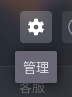
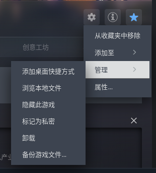
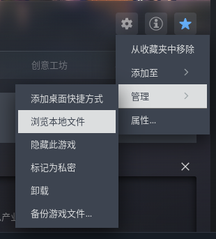

本文简要说明如何在戴森球计划上安装 Nebulae。 [此项目](https://github.com/Linwendong83/Nebulae) 修复了较多问题并且更适合简体中文玩家游玩。

Windows 和 Linux 均可以参考本教程。 macOS 未经测试。

<!--more-->

## 准备工作

!!! warning 注意
Nebulae 移除了 API 支持。依赖 Nebula API 的模组可能不会正常工作。
!!!

!!! note 获取帮助
[加入 QQ 群聊【戴森球计划联机交流群】](https://qm.qq.com/q/ZGkke3fTG0)

注意：帮助是完全免费的，其基于社区同好的高尚品德。不要将获得免费的帮助视为理所应当的权利。
!!!

首先，你需要有一个 Steam 正版的戴森球计划。

如果你使用 r2modman 来管理模组，请优先阅读 [r2modman](#特殊-r2modman) 节。

### 下载文件

然后，准备好以下文件：

若你加入了上文项目中提到的QQ群，那么以下文件都可以在 QQ 群文件中找到。

1. 适用于戴森球计划的 BepInEx 归档包。你可以在 r2modman 上下载。
2. Nebulae 发行包，可以从 [此 GitHub Releases](https://github.com/Linwendong83/Nebulae/releases) 下载修改版(推荐)。

### 解压文件

将上述文件解压并放在可访问的位置。作为示例，解压后的内容必须包含以下文件夹：

BepInEx: 

```
BepInExPack
 - BepInEx (文件夹)
   - core (文件夹)
     - ...
 - doorstep_config.ini
 - winhttp.dll
```

将上示例中的 `BepInExPack` 文件夹记为 **BepInEx源文件** 。

Nebulae:

```
Nebulae_xxxx
 - Nebulae (文件夹)
```

将上示例中的 `Nebulae_xxxx` 文件夹记为 **Nebulae源文件** 。

### 定位文件

按以下三步打开戴森球计划的安装目录：

<div style="display: flex; gap: .5rem; flex-wrap: wrap">







</div>

请保持此窗口打开，此目录记为 **安装目录文件夹** 。

## 安装

### BepInEx

将 **BepInEx源文件** 下的所有文件和文件夹复制到 **安装目录文件夹**。

你的 **安装目录文件夹** 看起来应该像这样：

```
BepInEx
Configs
DSPGAME_Data
Icarus
Locale
MonoBleedingEdge
Updates
Verta
Wiki
doorstop_config.ini
DSPGAME.exe
UnityPlayer.dll
winhttp.dll
...
```

然后，打开 **安装目录文件夹** 下的 `BepInEx` 文件夹，然后再其内部创建一个 `plugins` 文件夹。

创建完成后， **安装目录文件夹** 下的 `BepInEx` 文件夹应该像这样：

```
core
plugins
...
```

### Nebulae

将 **Nebulae源文件** 复制到 `plugins` 文件夹中。

复制完成后，**安装目录文件夹** 下的 `BepInEx/plugins` 文件夹应该像这样：

```
Nebulae
```

然后，你可以尝试从 Steam 启动戴森球计划。

在游戏版本、模组版本匹配的情况下，应该可以直接进行多人游戏。

## 小规模联机

### 主机创建世界

打开多人游戏页面，选择 **创建游戏 / Create Game** 配置新星系，
或选择 **载入游戏 / Load Game** 使用已有存档。
房间使用配置中的 `HostPort`，默认为 `8469`；密码通过 `ServerPassword` 设置。

局域网玩家连接主机的局域网地址；公网玩家连接能够访问主机的公网地址或域名。
公网直连需要让所选 **TCP 端口**能够到达主机，涉及路由器时配置相应端口转发。
可选的 UPnP / NAT-PMP 自动映射默认关闭，需要路由器支持并启用。

### 客户端加入

在多人游戏页面选择 **添加服务器 / Add Server** 保存地址，
或使用 **直接连接 / Direct Connect**。
填写地址与密码后加入，等待世界、工厂和运行状态同步完成后便可游玩。

下面是典型的地址格式：
```text
192.168.1.10:8469        局域网 IPv4
play.example.com:8469   域名
[2001:db8::10]:8469     IPv6，端口前使用方括号
```

未填写端口时使用本机配置中的 `HostPort`。地址解析也支持 `ws://`、`wss://` 前缀；模组自带服务端监听普通 WebSocket，使用 `wss://` 需要另行配置 TLS 入口。

服务器列表显示已保存服务器的描述、人数、延迟和兼容状态。

## Nebulae: 部署无头服务器

无头服务器仍运行游戏本体，但通过启动参数关闭图形界面，并由 Nebulae 接管联机会话。
它需要完整的游戏、BepInEx 和模组运行文件。

在游戏目录中用 PowerShell 启动，以下两种方式选择其一：

```powershell
# 示例：加载已有存档；名称对应游戏存档目录中的 session.dsv
.\DSPGAME.exe -nebulae-server -batchmode -nographics -load "session" -ups 60

# 示例：新建世界：种子 42、64 颗恒星、资源倍率 1，并使用简体中文默认星名
.\DSPGAME.exe -nebulae-server -batchmode -nographics -newgame 42 64 1 -star-name-lcid 2052 -ups 60
```

以下是支持的参数列表：

| 参数 | 含义 |
| --- | --- |
| `-nebulae-server` | 启用 Nebulae 专用服务器模式 |
| `-batchmode` | Unity 批处理模式 |
| `-nographics` | 关闭图形设备初始化，用于无界面运行 |
| `-load <名称>` | 加载游戏存档目录中的指定存档，可省略 `.dsv` 后缀 |
| `-load-latest` | 按文件修改时间选择最新的 `.dsv` 存档 |
| `-newgame <种子> <恒星数> <资源倍率>` | 按参数创建世界 |
| `-newgame-default` | 使用默认设置和随机种子创建世界 |
| `-newgame-cfg` | 按 `BepInEx/config/nebulaeGameDescSettings.cfg` 创建世界 |
| `-star-name-lcid <值>` | 新世界默认星名：`0` 为英文，`2052` 为简体中文；不改写已有存档 |
| `-ups <值>` | 设置模拟速率；`0` 不额外限制，通常使用游戏默认的 60 UPS |

启动时必须指定一种加载或新建方式。需要设置和平模式、沙盒模式和黑雾参数时，使用 `-newgame-cfg`；详细配置请查看源代码。

### 无界面护盾计算

星球护盾涉及计算着色器。Nebulae 提供独立的原生 D3D11、Unity Compute 和 CPU 实现，通过环境变量 `NEBULAE_SHIELD_BACKEND` 选择：

| 值 | 行为 |
| --- | --- |
| `auto`，默认 | 优先尝试原生后端，失败后根据可用性回退到 Unity 或 CPU |
| `native` | 强制原生 D3D11，需要原生 DLL 和通过 SHA-256 校验的着色器资源 |
| `cpu` | 使用 CPU 计算护盾物理数据 |

例如，在没有可用图形计算设备的环境中显式使用 CPU：

```powershell
$env:NEBULAE_SHIELD_BACKEND = "cpu"
.\DSPGAME.exe -nebulae-server -batchmode -nographics -load "session" -ups 60
```

`AutoPauseEnabled = true` 时，专用服务器在没有玩家在线时暂停世界，玩家加入后恢复。运行日志位于 `BepInEx/LogOutput.log`。

## 特殊：r2modman

本章节仅适用于使用 r2modman 管理模组的用户，其他用户在完成 [安装](#安装) 后无需阅读本节。r2modman 用户需优先阅读本节进行准备工作。

### 准备

下载 Nebulae 发行包，可以从 [此 GitHub Releases](https://github.com/Linwendong83/Nebulae/releases) 下载。

#### 解压

将上述文件解压并放在可访问的位置。作为示例，解压后的内容必须包含以下文件夹：

Nebulae:

```
Nebulae_xxxx
 - Nebulae (文件夹)
```

将上示例中的 `Nebulae_xxxx` 文件夹记为 **Nebulae源文件** 。

#### 定位

打开 r2modman 针对戴森球计划的目录。

在 Windows 下，其通常存储在 `%APPDATA%\r2modmanPlus-local\DysonSphereProgram\profiles\`，该文件夹包含你的戴森球计划配置文件。通常情况下，默认为 `Default` 。

在 Linux 下， `%APPDATA` 变为 `$XDG_CONFIG_HOME` 。

例如， `C:\Users\user\AppData\Roaming\r2modmanPlus-local\DysonSphereProgram\profiles\Default` 或 `/home/user1000/.config/r2modmanPlus-local/DysonSphereProgram/profiles/Default` ，将该目录记为 **安装目录文件夹** 。

然后，继续 [安装 Nebulae](#nebulae) 。

## Q&A

本节包含了可能在使用时遇到的小问题。

如果你的问题不在以下列表中，或列表里的解决方案没有解决你的问题，你可以 [加入 QQ 群聊【戴森球计划联机交流群】](https://qm.qq.com/q/ZGkke3fTG0) 或通过 GitHub Issues 反馈问题。

反馈问题时，你需要写明游戏版本、Nebulae 版本、主机或客户端角色、复现步骤、额外模组列表，以及对应日志。

### 联机端口是什么

Nebulae 的默认联机端口为 `8469`

### 版本不匹配

游戏版本和必要补丁覆盖检查通过后，模组才会启用联机协议。
主客机的 Nebulae 版本必须匹配。安装时请让所有玩家使用同一份 Nebulae 安装包，
并在主机更新时及时提醒玩家。

### 找不到联机入口

查看 `BepInEx/LogOutput.log`，确认游戏版本与 Nebulae 目标版本相同，依赖完整且没有重复插件。

### 连接超时

确认服务端已加载、地址和 TCP 端口正确，检查防火墙、端口转发与 IPv6 可达性。

### 加入时长时间加载

工厂规模、带宽与模型加载都会影响耗时。通常情况下这是由于存档过大导致的。

### 重连后被识别成新玩家

核对是否更换了 `player.key`、游戏数据目录或隔离运行实例。

### 联机存档无法加载或拒绝保存

检查 `.dsv` 与 `.server` 的世界身份是否匹配，尝试从同一份备份恢复配套数据。

### 无头服务器护盾后端初始化失败

检查原生 DLL、着色器资源与日志；可显式设置 `NEBULAE_SHIELD_BACKEND=cpu`。

