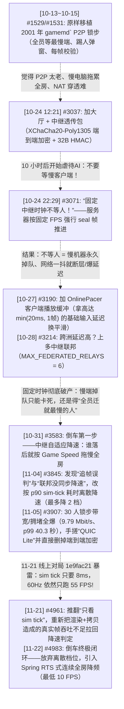

再看 V 项目源码。

<!--more-->

由于 V 项目的开发者们似乎对[上一篇文章](/posts/collections/rustyshit)的批判不尽满意并要求笔者或者衍生笔者提交一些推送请求来证明笔者是傻逼，或者其实是笔者偶然在一个 Rust AI 编程爱好者交流群看到有人挖出来 V 项目对[一个死了十几二十年的远古联机系统](https://cnc.fandom.com/wiki/Westwood_Online)进行了大笔适配，因此在[双子星](https://gemini.google.com)的协助下创作本文。

毕竟你自己的代码都是 AI 写的那我让 AI 看代码 AI 总结也没什么问题就像在那些 AIDE 里让 AI review 代码一样。
毕竟许愿式编程的第一要点就是相信自己的 AI ，当然许愿式写作也是，当然也因为作者被主观上认为没有任何编程基础，因此下面的内容全部**没有经过人工审查**以表敬意。

!!! important 个人观点
看起来联机系统是大屎山
!!!

以下内容大部分是 Gemini 创作的，特别是**事实**部分。

V 项目在联机问题上并不是“工程不够努力”——恰恰相反，核心贡献者和 AI 编码代理在这个方向上堆了极其庞大的工程量：仅 `src/net/`、`services/relay-protocol/`、`services/relay/`、`src/app/lan_service/`、`src/app/shell_wol/`、`src/app/match_runtime/`、`src/sim/command_queue/` 和 `src/sim/world/world_hash/` 这几个直接相关模块，就占了 **129,088 行 Rust 代码**（全库 `src/` 共 `1,907,632` 行，`services/` 共 `28,499` 行）。

那么我们有什么收获么？

...

没有

实际上联机系统从头到尾都在**原地绕大圈**：把确定性锁步的**理论局限与硬件算力上限**误判成了“传输协议和调度参数问题”，企图靠加一台云端中继服务器和一摞协议补丁去违抗锁步的物理定律，最终耗费一个多月、写穿几万行代码后，灰头土脸地退回到了起点并耗费了相当多额度，这额度还不如拿来做AI片呢。

---

## 一、 Cyclepath

翻看 V 项目从 2026-10-13 到 2026-11-25 的联机相关提交史，整条演进线几乎是一部“不信邪 -> 碰壁 -> 打补丁 -> 推翻自己 -> 回到原点”的行为艺术：

最具讽刺意味的是他们自己写在 `Networking.md` 里的这句自我供词（对应 `#4983` 的 `CertificatePacing::Continuous`）：

> `A lobby that turns on continuous pacing (certificate flags bit 2, below) lets the relay seal at any whole rate instead of Game Speed rows, **as lockstep LAN play follows its slowest player**: a slow player slows the match to its holdable rate... never below 10 frames a second.`

从 10 月 13 日移植原版“全员跟随最慢玩家”开始，到 10 月 24 日 `#3071`（`d4eee32f8`）幻想“固定中继时钟让好网络和快电脑不受慢玩家影响”，再到 11 月 22 日 `#4983`（`316fbee3e`）一路妥协回到“**像局域网锁步一样跟随全场最慢的那台电脑，最低全局降到 10 FPS**”——而且路上还把 `services/relay-protocol/src/sequenced.rs` 里 2001 年《帝国时代》（Bettner & Terrano）和 Spring RTS `CGameServer::LagProtection` 的老方案全重抄了一遍。

**绕这一大圈之所以必然发生，是因为他们没搞懂锁步联机的第一条铁律**：在没有状态同步（State Sync / Snapshot）能力的前提下，每台机器都必须在“相同初始状态 + 相同每帧输入”的基础上独立演化。**中继服务器根本不拥有模拟权**（`services/relay-protocol/src/lib.rs` 明写 `This transport owns no simulation state`）。你让中继单方面“按固定时钟往前走”，不等于慢机器能跳过计算；慢机器在锁步下**绝对无法跳过第 N 帧去跑第 N+1 帧**，结果只是把“全员等它”变成了“它永远落后、指令缓冲区爆满、彻底脱离战局直到 10 分钟超时判负”。一旦想让所有人继续一起玩，最后唯一的数学解就还是**木桶效应——全房锁死在最慢机器和最差链路的速度上**。

---

## 二、 为什么这条架构在工程上已经走死

### 1. 规模悖论

`README.md` 把核心目标定为：**`20,000 units`、`500×500 maps`、`30` 人 LAN 或在线联机**。但在锁步架构下，这等于强求**全场最弱的一台玩家电脑**，都必须每帧在时间预算内独立跑完场上全部 20,000 个单位 + 全部 AI + 全部寻路与弹道。也许他们认为现在玩红警的都人均 9800X3D 。

现实有多骨感？看他们自己 2026-11-24 在 Apple M4 Mac mini 上的实测（`scale-benchmark.md`）：
- 30 家、约 20,900–23,900 对象对局中：**平均单 tick 耗时 `85.5 ms`、p99 高达 `138.6 ms`、峰值 `222 ms`**；
- 即便是在能把耗时压到 `52.2 ms`（`22,142` 活体对象，见 sim-thread.md` Code Map 记录）的场景，离 60 FPS（`16.7 ms`）、45 FPS（`22 ms`）甚至 30 FPS（`33.3 ms`）的帧预算也相去甚远；
- 全线程池跑满也只利用了 **`2.2` 核**（4 线程时为 **`1.6` 核**），文档直言：**`the tick was one thread's work`**；
- 在模拟之外，客户端主线程还要再付 **`15.8 ms`**（`5.3 ms` 渲染 + `10.5 ms` 匹配服务/状态拷贝，其中给渲染层拷贝每条 `1,104` 字节的 `PresentationFrame` 在 2 万对象下光拷贝就要 `8.5–9.4 ms`）。

### ！？多线程？！

看上去这些开发者们[试图用**多线程拯救性能**](/posts/collections/rustyshit/#人类的终点是多线程)，但实际上可能是用多线程降低性能：

- **把模拟拆到独立线程**：在 `docs/sim-thread.md` 和 `src/app/match_runtime/sim_tick.rs` 里，每个联机帧在工作线程跑完 `Logic` 和校验后，走到 `Queue_AI` 就必须强行急刹车，通过 `FrameResume::QueueHandoff` 把状态全权交回主线程执行网络收发、校验对比与命令派发——工作线程和主线程之间依然是严格的串行锁步停顿。
- **核心循环多核分片并行**：在 `docs/sim-thread.md` 的实测统计中，按稳定 ID 顺序遍历对象时，每帧要发生 `154,380` 次自身读写、`548` 次修改其他对象状态以及 `15,691` 次写共用单元格网格。当他们试图按分片读取“本片写入 + 帧初快照”或哪怕只是倒序遍历一下同一个快照时，都会让`state_hash` 当场分叉，最后写了一个 `Status: set aside` 就不了了之了。
- 为了校验而拼出的 34 子系统全量哈希 `src/sim/world/world_hash.rs`（连同 `entity.rs` 共 `3,880` 行）完全起到了反作用，于是非常诚实地自己文档坦白说 **on a large map the hash alone can take longer than a frame's budget**，实在是令人失语。

### 2. Half QUIC

实际上我们可以大胆猜测v20k项目组的大部分开发者或者有机体子代理并不知道QUIC是什么，只知道原本的协议在 30 人局下根本跑不动。

后来在 `684561e9c` 被清理删掉、但完整保存在 git 历史 `0a2a519ad`（源自 `#3907` / `7b8cbe6dd`）中的 `services/relay/adaptive-transport/results.md` 实测数据把旧协议的惨状暴露无遗（`netsim` 30 Hz、300 APM）：
- 30 人良好链路：中继出口总带宽高达 **`9.79 Mbit/s`**（总吞吐 `1,495.7 KB/s`，每人 `49.86 KB/s`），空闲什么都不干时每名读者下行也有 **`48.5 包/s`**（adaptive-transport/spec.md）；
- 30 人上行 96 kbit/s 拥堵：p99 指令延迟飙到 **`22,483 ms`（22.5 秒）**；
- 30 人下行 256 kbit/s 严重拥堵：卡顿 **`47.2 次/分`**，p99 指令延迟飙到 **`40,280 ms`（40.3 秒）**！

#### 用了，不能改了

这本来应该是一个再清楚不过的警报：**全指令广播 + 高频定序包压根不适合 30 人高并发实时同步**。

但他们没有反省同步模型，而是选择在 UDP 之上写了一篇 1,246 行的 `adaptive-transport/spec.md` 和 452 行的 `bandwidth-compaction/spec.md`，自己手搓了一套 `LinkState`（Good/Lossy/Congested/Offline）、64 位收包位图 `RecvWindow`、SRTT/RTTVAR/RTO/PTO、丢包迟滞 `5‰/2‰`、排队延迟探测与按包补推。

#### 哦对的对的，哦不对不对

即便重写了一遍半套 TCP/QUIC 拥塞与重传状态机，包头依然压不下 30 人的广播膨胀，最后在 `bandwidth-compaction` 阶段做出了堪称脱裤子戴手套的取舍：
1. **彻底删掉了 `#3037` 时好不容易接上的端到端加密 `XChaCha20Poly1305`**：大厅协议返回了 payload key 却干脆不用（`services/relay-protocol/src/lib.rs`），线上指令包和落盘对局日志全部**明文裸奔**，中继自己就可以任意偷窥和伪造所有玩家的战术动作与聊天；
2. **把 32 字节完整 HMAC 截断成 4 字节（`HOP_TAG_LEN = 4`）**；
3. 更离谱的是，连安全边界都没算对，直到 2026-11-22 的 `f4ef7f4f8` 才被迫在规范里改口承认：对于已知 `session` 的伪造包，**错误 MAC 根本不扣 `16,384` 包/秒的入口限流预算**，只受中继单线程 recv+HMAC 速度限制；而按 `results.md` 第 5.3 节记录的 `2^-32` 概率，只要撞中 **1 个包**，路径上的攻击者就可以直接以该玩家身份伪造 `LEAVE` 把别人踹死、伪造 `UPLINK` 指令、把包端点迁走，或者把 `seq` 往前跳走直接锁死合法客户端直到下次续期，更别提换源地址根本不做路径 `CHALLENGE` 验证了。也许笔者可以手动进行一些攻击来验证这些效果但笔者显然道德尚存因此不会这么做。
4. 结果折腾完这一大圈：在 `2 人、RTT 200 ± 50 ms` 抖动链路下，改造后的每分钟卡顿从 `13.8 次` **恶化到了 `18.0 次`**（`results.md` 第 5 节自己也写了实测 `18 次 vs 14 次`），5 秒断线重连后 p99 延迟依然是 **`4,821 ms`**（改造前 `4,732 ms`），物理 RTT 摆在那里，协议层再怎么变戏法也救不了锁步的停等本性。

### 3. 哈哈哈哈希

把一个 1998–2001 年间写成的 C++ 游戏强行还原成跨平台 bit-exact 锁步，暴露出第二个根源性认知盲区：**`gamemd` 本身在逻辑和表现之间耦合极深，根本没有“纯逻辑状态边界”。**

或者他们不认为这是知识盲区就像狗也不认为他们叫狗。

在 V 项目里，动画帧数、建筑建造动画时长、气象武器贴图高度、体素尺寸都会影响逻辑推进与帧边界，于是他们陷入了“打地鼠式”的开局哈希和底层模拟补丁：
- **源码级全库强锁**：`build.rs` 在编译期就把整个 `src/`、`services/relay-protocol/src/`、Cargo 配置文件、`Terrain` 目录和所有启用的 feature 一起算成 `VERA20K_NETWORK_BUILD` 哈希。只要两端编译开关差一点或源码改动哪怕 1 字节，开局直接拒联。
- **美术资源哈希补丁与残余死角**：`src/rules/ruleset/config_hash.rs` 里为了防止不同步，不得不把 `buildup`、`terrain`、`rubble`、`voxel`、特定 SHP 动画帧范围、`weather_con_bolts` 的 `raw_shp_height` 全塞进校验哈希；然而第 1761–1766 行的注释自己就挂着 **`RESIDUAL`** 警示牌，老实交代目前只防住了 `DeployingAnim=`、心灵支配仪和闪电风暴云，**建筑延迟开火动画或 Ares 超武自带动画帧数一旦两端不同，“依然会把两局战斗撕裂开来”**。
- **原版校验漏洞与软件模拟 x87**：因原版 `Compute_Game_Sync_Checksum @ 0x0064DAB0` 连金钱、单位血量和触发器都不哈希，他们在 `src/sim/multiplayer_checksum.rs` 额外补了一套扩展校验；为了对齐原版老 CPU 行为，甚至在 `src/util/native_x87.rs`（具体把 x87 拉在哪了可以看[上一篇](/posts/collections/rustyshit/#2-祖宗之法不可变)）里用整数纯软件手搓了一套 `53-bit` 截断向零取整的 x87 浮点模拟器。但凡任何地方漏算 1 bit，没有状态纠偏机制，结果就是全盘不可恢复的 `OrderEntry::Desync` 炸房。

### 4. 没有状态快照能力的畸形产物

因为锁步系统只同步指令流、不具备世界快照同步能力，一旦要做哪怕一点现代联机游戏的常规功能比如**掉线重连**或**实时观战**就会让整个系统架构立刻长出一个堪比子代理大脑的畸形肿瘤：

#### 巨型账本

为了能让后来者重构世界，中继必须把整场对局从 `sequence 1` 开始的每一帧全部用**明文**写进磁盘日志（`services/relay/README.md`、`L473-L483`）。中继为日志预留 **`8 GiB`** 配额，官方文档自己算账说如果 110 场 2 人 60 FPS 对局并发，“总占用能冲到约 **`22 GB`**”；观战端（每场上限 `256` 人、全局 `1,024` 人）光是为了让延迟观战定位进度，就要存最多 `86,402` 个 24 字节的跳转标记。

#### 重连操作威力巨大

按 `docs/Networking.md` 规范，玩家崩溃或重开后重连，新进程拿到初始计时向量，跳过开局屏障，**从 `sequence 1`（第 1 帧）开始一路高速快进重放整局直到追上服务器当前帧**（`settle_restore`）；并且追帧期间本地操作全部静默丢弃（`local orders given until then are dropped`），`docs/sim-thread.md` 还明确指出重连追帧只能待在主线程同步跑。回想一下前面 M4 上 2 万单位一帧 `85.5 ms` 的数据——一局打了 20 分钟的大规模混战中途掉个线，重连得等地球转几圈？

### 5. 木桶式中继联邦

为了缓解单一中继对跨区玩家不公平的问题，他们在 `#3214` 做了一套最多 6 台服务器互联的**中继联邦**（`services/relay-protocol/src/sequenced/federation.rs`），配上了协调者时钟漂移校正、跨中继转发行程速率、跨机提交校验和。后来还发现联邦如果挂掉一台服务器就全屋卡死，又在 `#4642`（`outcome.rs`）补了一套 94 字节签名收据 `VFO1` + SQLite 落盘防篡改外箱，约定只要任意中继失联超过 10 分钟（`ABSENT_MS = 600_000`）就把整局判定无效（`FEDERATION_LOST`）。

然而绕了这么大一圈分布式工程，最后决胜帧率前进的核心代码只有那一行：`federation.merged_through`—— **在所有活跃中继已封存帧里取最小值 `min(link.sealed)`** 。

只要局内 6 台服务器里最远那一对链路一抽风，全网 30 个人的游戏一起停摆等这组 `min` 推进；而且代价是直接**禁用了跨中继对局的同步暂停功能**（`docs/Networking.md`、`services/relay/README.md`）。

本来用中心化中继就是为了简单可靠，结果联邦把单点中继变成了多机短板串联，同时又完全保留了锁步最脆弱的那部分。

也许这无可厚非毕竟**游戏开发者可能既不玩游戏也不是开发者**。
笔者也不知道这些开发者怎么看使用六台服务器后稳定性反而不如一台的返祖现象。

---

## 三、 总结

如果真正理解锁步联机的原理与局限或者至少了解锁步联机，就应该在一开始认清三条边界，而不是盲目用什么看上去很高大上的十几万行代码 + 中继联邦 + 连续降频 + 砍加密等诡秘修改去硬刚：

1. 锁步只适合计算极轻量、人数有限、可容忍最慢端拖累全房的场景比如你画我猜。一边喊着 20,000 单位 + 30 人全球联机（单核都算不动，跨网必有高 RTT 慢端），一边死抱着每台机器逐比特演进全世界的原教旨锁步，也许这些开发者应该出版一本《图灵进化论》以证明达尔文在演化上是个外行。

2. 锁步没有状态权威，也就没有魔法能变出“不互相拖累的低延迟”、“秒级断点快照重连”和“天然抗外挂视野隔离”。所有玩家内存里永远完整模拟着全图所有人的经济、视野和单位，`docs/Networking.md` 甚至就是靠全员世界全量模拟来做观战切换视角的。

3. 真正面向 30 人超大规模的联机架构，要么走`***`，把算力压力和作弊面收敛到服务端（或做`***`），要么一开始就老老实实承认经典锁步的合理体量上限（例如`***`）。

> 也许笔者知道些什么，但既然这些开发者们都认为笔者是傻逼所以即使知道也不会给出建议。 

V 项目恰恰反了过来：底座死守 1998 年 `gamemd` 的全图全量锁步和耦合逻辑，上面却强行架设“2 万单位 × 30 人全球多中继联邦”。结果就是每解决一个老问题，就会因为触犯锁步底层定律而炸出两个新问题，导致 Bug 满天飞越飞越多。

!!! important 重大发现
我操。！这其实是自催化和手性放大因为他们让优缺点都导向了缺点。笔者认为如果他们继续这项研究肯定可以获得2027年计算机化学奖。
!!!

最后祝贺 V 项目在 13 万行代码和十几个自相矛盾的 PR 之后，回到 `CertificatePacing::Continuous` 这个 10 FPS 超级大木桶的原点。
