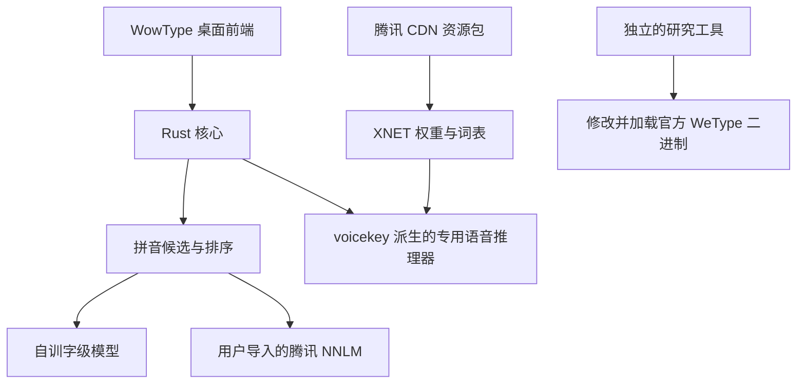

对 WowType 所声称的“没有用微信输入法的任何代码、词库或模型”进行初步审查。

<!--more-->

观前提醒：
审查由 GPT-6.1-Sol 参与并编写研究报告。
审查结果不具备法律效力。
若您想获取完整的审查结果，可通过[邮箱](mailto:alanqa-ops@outlook.com)联系。

!!! important TL;DR
WowType 仓库包含实质性的微信输入法逆向工具，
桌面语音链路直接使用腾讯模型，
拼音核心支持导入并优先使用腾讯的字级语言模型。
相应的第三方使用与再许可依据在本次取得的公开材料中没有形成完整证据链。
!!!

[WowType](https://github.com/Gloridust/WowType) 是一个提供 Linux fcitx5 和 macOS 前端的输入法项目，主打接近微信输入法的使用体验。它的 README 将引擎描述为 Rust 实现，声明代码采用 MIT / Apache-2.0 双许可证，同时说明语音使用微信输入法的离线模型。

本次审计重点在于这些描述背后实际存在怎样的技术和授权关系：哪些是自行实现，哪些来自第三方代码，哪些仍然需要腾讯的模型；所谓“参考体验”，又涉及多深的原程序分析。

> [!NOTE]
> 本文审查的是 2026 年 11 月 21 日取得的固定版本，不是对项目今后所有版本的评价。逆向工程、模型使用、再分发和服务认证绕过是不同的问题。本文仅确认技术事实与授权风险。

## 审计对象

WowType 的审计基线是提交 [`ebbe4c88d52f7ca6ddf27c4b062f913b79ad269b`](https://github.com/Gloridust/WowType/tree/ebbe4c88d52f7ca6ddf27c4b062f913b79ad269b)。对其 328 个受跟踪文件记录了摘要，并检查相关本地 Git 历史。随后下载了代码指定的腾讯语音资源包，以及语音实现所引用的 voicekey 上游源码。后者固定在提交 [`070931b97dcb8faaf8d5085c5ed18e16d7bdcdc2`](https://github.com/J3n5en/voicekey/tree/070931b97dcb8faaf8d5085c5ed18e16d7bdcdc2)。

检查包括源码、注释、提交记录、资源包完整目录、文件摘要、包内签名的内部一致性，以及实际模型的张量记录。

WowType 及相关内容的分发和使用大体上可以被简化为以下图：

WowType 基于 Fcitx5 及桌面套件实现了自己的核心和前端，不能简化为微信输入法的拆壳又套壳的结果。
但“自己实现推理代码”与“使用自己拥有完整权利的模型”，同样不能画等号。

## 语音部分

!!! important TL;DR
语音识别使用直接从腾讯服务器获取的模型。
XNET 实现是否合法尚无公开证明材料，但可能违反腾讯用户协议。
!!!

### 语音模型来源

语音部分的来源不是从名称推测出来的。`voice/src/wtlocal/pack.rs` 直接写明腾讯 CDN 地址、固定包名、大小与 MD5；设置界面和 macOS 安装器也有对应实现。[^voice-package]

本次实际取得的资源名为 `20260710220526250_ime_asr_decoder_model.apk`，检查结果如下：

| 项目 | 实测值 |
|---|---|
| 大小 | 102,920,639 字节 |
| MD5 | `28386481eb94ff73b28ee3949c0cf690` |
| SHA-256 | `b3729fbe928b25740cc9cd781537175b1db4a445bd78bf464267c0c4633e0863` |

三个值与代码中固定的值完全吻合。外层是包含签名材料的 ZIP，其中套着 `ime_asr_decoder_model.zip`；内层只有六个文件：

| 文件 | 作用 |
|---|---|
| `CMS.40.bin` | 特征归一化资源 |
| `dict.decoder.gbk.txt` | GBK 词表 |
| `dict.decoder.utf8.txt` | UTF-8 词表 |
| `feature.conf` | 特征配置 |
| `sr_online.conf` | 识别配置 |
| `embed_140m_kld43wh_test_78000_1_merge_4.kv.conv1d.dyQu.onnx.xnet` | 135,646,496 字节的模型文件 |

这个具体资源包里没有引擎源码，也没有 LICENSE、NOTICE 或 EULA 文件。两个配置文件中也没有授予第三方使用权的文字。这里的范围必须说清楚：**检查的是这一颗资源包，不能据此宣布完整微信输入法客户端没有许可证，或其他地方绝不存在专项授权。**

包内文件可以用标准 ZIP 库直接读取，不需要密码或解密。模型头部是 `XNET`。独立的有界解析检查得到 1,170 项记录，发现 `layers.0` 到 `layers.39`；针对 WowType 代码所要求的 480 个逐层张量名称和形状，检查全部匹配。UTF-8 词表有 10,502 行，输出偏置的形状也是 `[10502]`。

因此，现在有两层彼此对应的证据：代码会按特定名称读取腾讯模型权重；实际下载的模型中，确实存在它所要求的张量结构。它是一条已经写进产品的具体模型使用路径，不是仅供讨论的设计草案。[^voice-model]

结构匹配仍然不等于推理数值等价，更不等于语音识别效果已经验收。包内签名的摘要与 CMS 签名内部一致性也通过了检查，但没有用独立的官方已知指纹确认签名者身份；即使身份完全确认，签名仍然不能代替模型使用许可。

### XNET 实现

腾讯输入法使用闭源的 XNET 引擎，目前尚未找到任何官方开放使用的 XNET 实现。

WowType 的 NOTICE 明确称，离线识别代码来自 [J3n5en/voicekey](https://github.com/J3n5en/voicekey) 的 `crates/wtlocal`，“经作者同意后引入”，并列出线程、文件读取和接口等适配。对两个固定版本进行比较，`xnet.rs` 的差异只是格式调整；模型与特征代码则有实际修改。来源关联有代码支持。[^voicekey-origin]

这套实现所做的事情相当具体：

- `xnet.rs` 读取权重记录，返回名称到类型、维度、偏移的映射。
- `model.rs` 把网络固定为卷积前端与 40 层 Transformer，隐藏维度 512、8 个注意力头、前馈维度 2048。
- 前向计算由 Rust 代码写出，权重按 `layers.{i}.attention.q_conv` 等已知名称取得。

这是一套从专有容器中取出已知权重，再运行特定网络的兼容推理器。由于 XNET 不公开源代码，无法查证其是否完整实现了 XNET 的功能。[^xnet-code]

许可是另一层问题。在取得的 voicekey 完整源码树中，
未见根目录或 `crates/wtlocal` 的项目级 LICENSE、COPYING 或 NOTICE 许可全文；
找到的 `sounds/LICENSE.md` 只针对声音资源。
相关 Cargo 清单没有声明许可证。

voicekey README 的声明是：

> 本项目通过分析输入法客户端协议实现，仅供学习与个人使用，与字节跳动、腾讯、阿里巴巴、网易无关。

这并不是一份授予修改、商业使用、再分发等完整权利的标准开源许可证。[^voicekey-license]

所以，现阶段准确的说法是：**第三方专用实现的源码公开可读，没有取得这套实现适用的完整许可。** 这不证明其他地方绝不存在实现，也不能认为这些 Rust 代码是腾讯源码泄漏。

WowType 所称的作者同意，可能确实通过私下沟通取得。本次没有拿到同意原文、适用版本和再许可范围，不能反过来断言没有授权。但即使 voicekey 作者允许使用其代码，也不能自动授予腾讯模型的使用权。

## 拼音部分

!!! important TL;DR
WowType 明确将使用腾讯的语言模型作为支持选项。
!!!

语音并不是唯一与腾讯权重有关的功能。

`core/src/nnlm.rs` 的文件头就说明，它同时读取两种字级神经语言模型：WowType 自训的 `nnlm.bin`，以及微信输入法中的 `nlrgpt2_nnlm.bin`。后者由用户从本地安装包导入，核心中有真实的容器、TFLite 张量和字表解析，以及前向计算代码。[^nnlm]

Linux 插件的 `findNnlm` 则明确规定了选择顺序：

1. `WOWTYPE_NNLM` 环境变量指定的文件；
2. 用户导入的 `wetype/nlrgpt2_nnlm.bin`；
3. WowType 自训的 `nnlm.bin`。

也就是说，存在导入的腾讯模型时，它会优先于自训模型被选择。这已经超出了“仓库里放着一个没接入的研究解析器”。[^nnlm-selection]

这也使 README 中“拼音引擎没有用它的任何代码、词库或模型”的概括显得不够准确：若指默认包采用的数据，应当明确限定；若概括所有功能，则与可选腾讯 NNLM 路径相冲突。[^readme]

同时，仓库确有自行训练模型的代码：新建模型、训练优化、保存和导出的路径都存在，来源标为 LCCC 与中文维基。不能因为网络架构相同，就指控自训模型只是腾讯权重改名，同样也不能证明自训模型和腾讯没有关系。。原始语料、训练记录与发布文件之间的可复核绑定，属于需要继续补齐的来源材料。[^training]

## 研究工具

!!! important TL;DR
WowType 确实深度拆解了微信输入法的发行程序。
!!!

如果只看到“参考体验”“行为对照”几个词，很容易低估仓库中的研究深度。

`tools/ref-engine/README.md` 给出了修改官方 WeType 二进制的步骤：取得 arm64 切片，把 Mach-O 文件类型从可执行文件改成 bundle，进行本地 ad-hoc 重签，再构造临时 app 目录，将原程序的资源与框架链接过去，以便动态加载。[^ref-engine]

对应的 `probe_runtime_patch.c` 不只是文档示例。它包含实际的代码页权限修改、机器指令覆盖和指令缓存刷新逻辑；其他探测工具还通过固定地址访问内部对象和函数。[^patch]

这些足以确认实质性的逆向分析与原程序修改。但仓库作者记录的实验结果仍需要与独立复现区分。

尤其不能把“打补丁”直接翻译成“破解授权”。当前记录中的 patch 用来跳过空子词典的虚函数调用、排查会话创建崩溃。没有证据表明这里绕过了登录、计费或 DRM。

同样，工具里虽然有词典遍历和输出逻辑，但仓库自己的记录指出，词条字段读不出来，完整词库导出仍然走不通。批量候选输出与排序蒸馏集，被写在“下一步”中；不能把计划当成已经得到并投入训练的数据。[^extraction-limit]

还有一条值得保留的历史记录。提交 [`38a6749`](https://github.com/Gloridust/WowType/commit/38a6749078d8a3551d9cdabe01cf5bdddc9b28b6) 的正文写道：

> 文档与工具命名改成更中性的说法，避免自动化工具误判：
>
> ……文档里的「逆向/反汇编」改为「格式分析/静态分析/指令级分析」……
>
> 内容与结论不变，只调整措辞

这证明了改名及其公开说明，但不能凭此完全认为作者是在逃避法律审查。
不过关键词会变化，代码行为不会因为措辞变化就消失。

## 官方协议

!!! important TL;DR
WowType 与腾讯用户协议存在条款冲突。
!!!

授权风险并不只有“仓库没放许可证”这一条依据。

从微信输入法官网的“用户协议”链接，可以取得[《微信输入法软件许可及服务协议》](https://z.weixin.qq.com/web/agreement)。本次留档版本标注的更新与生效日期均为 **2026 年 5 月 11 日**。[^agreement]

其中，3.2.1 授予的是个人、不可转让、非排他的许可，允许为非商业目的在单一终端设备上使用软件；3.2.3 保留其他未明示授权的权利，要求另取书面许可。8.2 则明确写道：

> 未经腾讯或相关权利人书面同意，你不得为任何商业或非商业目的自行或许可任何第三方实施、利用、转让上述知识产权；你不得对本软件进行反向工程、反向汇编、编译或者以其他方式尝试发现本软件的源代码……

它至少说明，不能把“腾讯 CDN 上谁都能下载”解释成腾讯已经给予第三方输入法广泛的模型使用许可，也不能把“用户自己下载、不随包分发”当成对授权问题的完整回答。

> [!IMPORTANT]
> 当前存在的是明确的条款冲突风险。网页上的现行协议，不是特定开发者当年接受某一版本的证明；是否有专项许可、书面同意，以及合同适用性、条款效力和法定例外，仍需另外核实。把条款与源码并排放置，不能代替这些判断。

这里至少有两组需要分别回答的问题：
1. voicekey 代码可以按什么条件引入和再许可？
2. 腾讯模型可以按什么条件抽离，并由第三方实现运行？

WowType 的 MIT / Apache-2.0 总体声明不能自行替这两组权利人作出授权。

## 证据足够说明什么

本次最扎实的结论，是一条具体的来源关系：腾讯语音资源包包含实际被解析的权重与词表；voicekey 提供专用兼容实现，WowType 在此基础上适配并接入桌面；另有腾讯 NNLM 导入和优先选择路径，以及独立的原程序逆向工具。

公开材料尚未补齐的是这些关系对应的授权依据。对使用者和后续开发者而言，最有价值的补充会是具体版本、具体文件与具体权利范围而不是笼统的“已经致谢”“没有分发模型”或“纯 Rust”等表面用词。

这次审计也没有证明腾讯源码泄漏，没有证明破解腾讯在线服务，没有证明完整微信词库成功导出，没有证明当前自训权重来自蒸馏，也没有检查所有历史发行包来认定“从未分发”或“已经分发”腾讯权重。腾讯公开发布的 HY-MT 翻译模型也应按其自身许可单独核验，不能因为同样来自腾讯，就与微信输入法的专有模型混为一谈。

[^voice-package]: WowType 固定版本：[Rust 资源常量与解包](https://github.com/Gloridust/WowType/blob/ebbe4c88d52f7ca6ddf27c4b062f913b79ad269b/voice/src/wtlocal/pack.rs#L11-L66)、[macOS 的 SHA-256](https://github.com/Gloridust/WowType/blob/ebbe4c88d52f7ca6ddf27c4b062f913b79ad269b/macos/Sources/App/VoiceModelInstaller.swift#L10-L16)。下载地址可从这两处复核；本文记录的是实物摘要与目录，不转载完整词表和权重。

[^voice-model]: [模型加载、固定张量名称与尺寸](https://github.com/Gloridust/WowType/blob/ebbe4c88d52f7ca6ddf27c4b062f913b79ad269b/voice/src/wtlocal/model.rs#L96-L150)、[XNET 记录解析](https://github.com/Gloridust/WowType/blob/ebbe4c88d52f7ca6ddf27c4b062f913b79ad269b/voice/src/wtlocal/xnet.rs#L44-L122)。本文的 1,170 项与 480 项检查来自对下载实物的独立元数据解析，不是直接采用项目宣称的识别成绩。

[^voice-runtime]: [默认 voice feature](https://github.com/Gloridust/WowType/blob/ebbe4c88d52f7ca6ddf27c4b062f913b79ad269b/core/Cargo.toml#L51-L56)、[语音 FFI 的下载边界与模型缺失处理](https://github.com/Gloridust/WowType/blob/ebbe4c88d52f7ca6ddf27c4b062f913b79ad269b/core/src/voice_ffi.rs#L1-L108)。

[^voicekey-origin]: [WowType 的来源与授权声明](https://github.com/Gloridust/WowType/blob/ebbe4c88d52f7ca6ddf27c4b062f913b79ad269b/voice/src/wtlocal/NOTICE.md)。`xnet.rs` 的文本比较在去除空白及闭括号前可选尾逗号后相同；这支持移植关系，不等于编译后等价性验证。

[^xnet-code]: voicekey 固定版本：[记录解析器](https://github.com/J3n5en/voicekey/blob/070931b97dcb8faaf8d5085c5ed18e16d7bdcdc2/crates/wtlocal/src/xnet.rs)、[固定网络与前向计算](https://github.com/J3n5en/voicekey/blob/070931b97dcb8faaf8d5085c5ed18e16d7bdcdc2/crates/wtlocal/src/model.rs)。此处只评价检查到的实现，不声称已经遍查所有 XNET 项目。

[^voicekey-license]: [voicekey 固定版本完整树](https://github.com/J3n5en/voicekey/tree/070931b97dcb8faaf8d5085c5ed18e16d7bdcdc2)、[README 声明](https://github.com/J3n5en/voicekey/blob/070931b97dcb8faaf8d5085c5ed18e16d7bdcdc2/README.md#L176-L178)、[wtlocal 清单](https://github.com/J3n5en/voicekey/blob/070931b97dcb8faaf8d5085c5ed18e16d7bdcdc2/crates/wtlocal/Cargo.toml)。README 随后的“语音会发送到对应厂商服务器”涉及项目的在线渠道，不能据此说本地 wtlocal 推理会上传录音。

[^nnlm]: [WowType 对两种模型的说明](https://github.com/Gloridust/WowType/blob/ebbe4c88d52f7ca6ddf27c4b062f913b79ad269b/core/src/nnlm.rs#L1-L12)、[腾讯模型解析实现](https://github.com/Gloridust/WowType/blob/ebbe4c88d52f7ca6ddf27c4b062f913b79ad269b/core/src/nnlm.rs#L87-L159)。

[^nnlm-selection]: [Linux 插件的 findNnlm](https://github.com/Gloridust/WowType/blob/ebbe4c88d52f7ca6ddf27c4b062f913b79ad269b/fcitx5-addon/src/wowtype_engine.cpp#L263-L279)。

[^readme]: [README 工作原理](https://github.com/Gloridust/WowType/blob/ebbe4c88d52f7ca6ddf27c4b062f913b79ad269b/README.md#L552-L563)、[总体许可证声明](https://github.com/Gloridust/WowType/blob/ebbe4c88d52f7ca6ddf27c4b062f913b79ad269b/README.md#L610-L612)。

[^training]: [训练脚本的新建模型、元数据与训练路径](https://github.com/Gloridust/WowType/blob/ebbe4c88d52f7ca6ddf27c4b062f913b79ad269b/tools/nnlm/train.py#L167-L250)。存在训练代码不能单独认证发布权重来源，但也不能在没有进一步证据时把它说成伪造。

[^ref-engine]: [官方引擎参考工具的二进制改造与资源布局说明](https://github.com/Gloridust/WowType/blob/ebbe4c88d52f7ca6ddf27c4b062f913b79ad269b/tools/ref-engine/README.md#L1-L29)。

[^patch]: [运行时 patch 的实际实现](https://github.com/Gloridust/WowType/blob/ebbe4c88d52f7ca6ddf27c4b062f913b79ad269b/tools/ref-engine/probe_runtime_patch.c#L38-L85)、[文档中的崩溃排查说明](https://github.com/Gloridust/WowType/blob/ebbe4c88d52f7ca6ddf27c4b062f913b79ad269b/tools/ref-engine/README.md#L88-L108)。

[^extraction-limit]: [词典遍历限制的历史提交](https://github.com/Gloridust/WowType/commit/b213b1bdd7f47df3737c8188d5dd071840f1037a)、[尚待完成的批量输出与蒸馏计划](https://github.com/Gloridust/WowType/blob/ebbe4c88d52f7ca6ddf27c4b062f913b79ad269b/tools/ref-engine/README.md#L74-L86)。实验结果是仓库作者记录，本次没有运行官方程序复现。

[^agreement]: [微信输入法官网](https://z.weixin.qq.com/)及其链接的[软件许可及服务协议](https://z.weixin.qq.com/web/agreement)，获取于 2026-11-21，重点为 3.2、8.1、8.2、11.1–11.2。官网页面可能更新，本文条款引述对应上述日期留档版本。现行文本不能自动证明开发者先前接受的具体版本，也不排除另有授权或法定例外。
